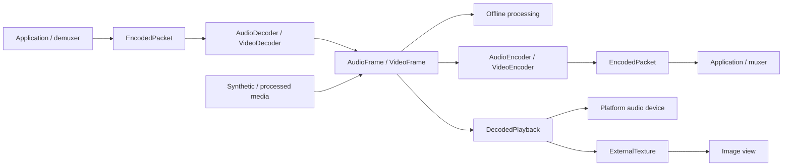

# Codec and decoded-playback design

The shared CPU media values, AAC/AVC decoders, AAC-LC/H.264 encoders, and six-platform PCM playback are
implemented. The [codec guide](media-codec.md) records platform validation and the encoder limitations. The
[PCM acceptance section](#first-implementation-and-acceptance) records playback validation and the remaining work.

The current implementation provides typed asynchronous capability snapshots and concrete asynchronous Probe calls.
Discovery distinguishes supported, unsupported, and unknown facts, with separate library/platform bounds and independent
H.264 B-picture policies. It reports hardware availability only when reliably knowable, without hardware selection. Windows
starts with synchronous system MFTs; Linux requires GStreamer. Video decoding reserves a conservative
34-frame capacity and a 16-frame presentation window. Low-latency tuning, asynchronous MFT enumeration, hardware policy,
and platform optimizations remain later milestones. Runtime acceptance is recorded separately for each platform.

Lib-Media will implement the codec foundation first, then build decoded-input playback on the resulting media values.
Encoding belongs to the codec feature, but completing every encoder is not a prerequisite for decoded playback.
Android, iOS, macOS, Windows, Linux, and Web are all design and implementation targets. Delivery is organized by
capability, with platform feasibility checked before freezing shared interfaces; desktop and browser semantics are
not deferred until after mobile API decisions. This document does not change the existing MediaPlayer or photo-library APIs.

## Requirements and ownership

[Issue #20](https://github.com/HuxerUI/HuxerUI/issues/20) requests independent codec sessions, capability discovery,
explicit ownership, and deterministic asynchronous processing. [Issue #102](https://github.com/HuxerUI/HuxerUI/issues/102)
requests playback of decoded input, including audio output, video scheduling, and synchronization. Their original SDK
packaging language is superseded by the agreed Lib-Media repository, namespace, and `HuxerUI::Media` target.



| Owner | Responsibility |
| --- | --- |
| Application or source library | Reading, container parsing, stream selection, source seeking, and coordinating independent sessions |
| Codec session | Configured conversion between encoded packets and raw frames, with bounded buffering |
| DecodedPlayback | Device output, playhead, audio/video queues, frame selection, and synchronization |
| ExternalTexture | The currently selected visual frame and renderer synchronization |
| Existing MediaPlayer | Complete-source playback through platform players |

No file/URL loader, demuxer, muxer, editing graph, or global codec registry is introduced in this phase. MP4 bytes are
not decoder input: the caller must supply complete codec access units and initialization data. Tests use packaged
packet fixtures with known boundaries and timestamps, rather than growing a container parser inside the decoder.

## Public surface and naming

All types remain in `huxerui::media`. Public headers and remaining planned headers are:

| Header | Proposed contents |
| --- | --- |
| `media_format.h` | Exact timestamps, audio/video format descriptions, encoded packets, and owned raw frames |
| `media_codec.h` | Capability probes, codec configuration, errors, and typed encoder/decoder sessions |
| `media_playback.h` | Decoded-input playback, starting with PCM output and a playback clock |
| Existing `media_player.h` | Existing file/reference/URL player, unchanged |
| Existing `media_library.h` | Existing selection and publication, unchanged |

Use `AudioDecoder`, `VideoDecoder`, `AudioEncoder`, and `VideoEncoder` as concrete, move-only session handles. These
four names express different input/output types; they do not imply four copies of the internal queue/state machinery.
Use `DecodedPlayback` for the later combined audio/video consumer. Do not overload MediaPlayer with raw-frame inputs,
introduce a public Session base class, or create separate AudioBuffer, PCMBuffer, and AudioFrame wrappers for the same data.

Use `platform` for backend APIs and objects, including video storage. Use `system` for operating-system scheduling,
tasks, requests, and assigned identifiers. Preserve established ABI and format names such as JNI and native byte order.

Errors use the installed SDK's `Result<T, CodecError>`. `CodecError` owns codec-specific codes, a diagnostic message,
and a platform diagnostic identifier. Reusing playback's `MediaError::fatal` or photo-library errors would import
unrelated lifecycle meanings. Proposed categories are `Unsupported`, `InvalidArgument`, `InvalidState`, `InvalidData`,
`ResourceExhausted`, `PlatformFailure`, and `Closed`. Queue saturation is an ordinary submission outcome, not an error.

## Shared media values

### Time

Introduce one exact `MediaTimestamp` value containing a signed 64-bit tick count and a positive 32-bit timescale.
Its value is ticks / timescale seconds. This represents 44.1 kHz samples and 90 kHz video timestamps without cumulative
floating-point rounding. Negative presentation times are legal for preroll. Missing timestamps use `std::optional`,
not a reserved integer or NaN.

Packets carry required PTS, optional DTS, and optional duration. Frames carry required PTS; audio duration is derived
from sample-frame count and sample rate, while video duration can be unknown. Duration values use the same rational
representation and must be nonnegative. DTS determines packet submission order when provided; PTS need not be monotonic
in compressed input. Session data belongs to one stream and one timeline generation.

Arithmetic uses checked rational operations. Platform conversion rounds to the nearest supported tick, with a documented
tie rule and overflow rejection; durations are calculated from absolute sample positions rather than adding rounded
per-buffer durations. Preserve the existing double-based `MediaTime` for MediaPlayer/UI compatibility. Conversion at
that boundary is explicit; existing player signatures are not migrated as part of this feature.

### Audio

`AudioFormat` describes sample rate, sample representation, packing, and an ordered channel layout. Start with signed
16-bit and float32 PCM, interleaved or planar, with mono and stereo layouts. Format support is queried, not assumed.
Channel count is derived from the layout; bytes per sample and frame duration are derived rather than separately stored.
Other layouts and representations return `Unsupported` until implemented.

`AudioFrame` is a retained read-only value with a format, PTS, sample-frame count, and planes. A sample frame contains
one sample per channel. Interleaved audio has one plane; planar audio has one plane per channel. Validate frame counts,
plane sizes, multiplication overflow, and alignment before submission. Audio format conversion, resampling, and mixing
are separate operations; the codec API must not silently substitute an application's requested output format.

### Video

`VideoFormat` describes coded pixel size, visible rectangle, pixel layout, pixel aspect ratio, and color metadata
(primaries, transfer, matrix, and range). Unknown color facts remain unknown; they are not silently labeled sRGB.
Rotation is presentation metadata, not an implicit rewrite of decoded pixels.

`VideoFrame` owns its format, PTS, optional duration, and retained planes. Each plane carries a byte range, row stride,
and pixel stride. Validation accounts for subsampling, visible crop, the final addressed sample, and integer overflow;
planes are never assumed tightly packed. The initial CPU layouts are I420 and NV12 for decoder output. Packed RGBA/BGRA
are candidates for later presentation input, not a reason to convert every decoded frame to RGB.

CPU output is library-owned. Platform SDR output retains an IOSurface-backed NV12 buffer on macOS and iOS,
a hardware buffer lease on Android, a DXGI sample on Windows, or a WebCodecs frame on Web. Both storage modes
use the same format and timing events. Android direct preview releases selected MediaCodec pictures into an SDK
SurfaceStreamTexture.
`MakeVideoFrame()` acquires one published SDK image and retains its texture owner with the frame. Encoders keep
the image through platform use. This preserves a decoder reservation attached to a texture and lets callers retry
the same frame under backpressure even when the texture receives another publication.
See [GPU video](gpu-video.md) for synchronization and retirement.

### Encoded packets and configuration

`EncodedPacket` contains a retained payload, timing, and a random-access/key-frame indication. It is one complete codec
access unit for one stream. There is no filename, URL, track registry, or implicit container ownership in this type.

Configuration distinguishes the codec from its packet representation. The initial implemented formats are:

| Codec | Input contract |
| --- | --- |
| AAC-LC | One raw AAC access unit per packet, with AudioSpecificConfig supplied at decoder creation; no implicit ADTS parsing |
| H.264/AVC | Length-prefixed access units with AVCDecoderConfigurationRecord and its NAL length size; no implicit Annex B detection |

Adapters may perform the small, bounded packet/configuration conversion required by their platform API. That conversion
must be explicit in adapter tests and is not general demuxing. Reject malformed initialization data, truncated lengths,
and unsupported profiles before unsafe platform submission. A video stream begins at a decodable random-access point;
reset requires a fresh random-access sequence. Testing includes frame reordering, not just all-intra fixtures.

Encoder output configuration is delivered before packets that depend on it. Packet PTS/DTS, key-frame flags, and encoder
priming/padding metadata must survive adaptation where reported. Missing DTS or trimming metadata stays explicitly
unknown; it must not be fabricated from PTS. Initial encoder support may reject frame reordering if DTS cannot be
reliably represented by the backend.

## Storage and bounded memory

Reuse SDK `Bytes` and `BufferReference` for byte storage and retained read-only ranges. The latter is not an immutable
snapshot by itself: its owner can still mutate backing storage. The initial submission rule is therefore deliberately
simple for the initial implementation:

- `TrySubmit(const EncodedPacket&)` copies an accepted payload into the bounded input pool before returning. Callers
  can reuse their source bytes after return. A rejected submission consumes nothing.
- Decoder output is copied or normalized into owned CPU-frame storage before the platform output slot is released.
  Its lifetime is independent of session reset and close. There is no public `ReleaseOutput(index)` operation.
- Future encoder frame submissions use the same copy-on-accept rule initially. A retained-input fast path is a separate
  future decision requiring an explicit immutable-storage or completion contract.

`QueueLimits` specifies maximum input items/bytes and output items/bytes. A packet or maximum configured frame that
cannot fit is rejected as invalid configuration/data, not left permanently in a WouldBlock state. Counts include queued
and in-flight reservations; output allocations still retained by consumers continue to charge the same output pool.
Reset does not create a new unlimited pool while old output references survive. Old outputs remain readable and can
apply backpressure to a new generation until released.

Copied-input credit follows the last retained byte owner, including adapters that hold an input callback buffer beyond
frame production. Once platform submission no longer needs those bytes, the session retains timing only; in-flight platform
conversion remains charged to output reservations. Each adapter reserves output capacity before scheduling work, including platform reordering/delay allowances. It may stop
feeding platform input when credit is exhausted. If a backend cannot bound outstanding callbacks/platform allocations, that
configuration is unsupported in the bounded mode. Input duration and codec delay must be considered for audio packets
that can produce more than one output buffer. Do not promise a fixed process RSS: platform-internal allocations are
measured separately from the library's item/byte bounds and constrained by configured dimensions and codec limits.

Output release is thread-safe and wakes producers without calling user code from a buffer destructor. No queue silently
drops codec output. An application that retains all output must expect backpressure; drain cannot complete indefinitely
without the caller reading and releasing output.

## Execution model

The codec core uses no `View`, `Runtime`, window module registration, or `Install()` hook. Construction selects the
compiled platform adapter directly. An adapter may require a platform event loop, JVM availability, or a particular worker
context; those restrictions are capability facts, not a requirement to create a HuxerUI Runtime.

The installed SDK's `AwaitCallback` starts on a running Task's UI thread and resumes through its dispatcher. It is an
optional UI adapter, not the codec execution mechanism. The core uses nonblocking queue/control operations and callbacks
that also work in a native command-line program or a browser DedicatedWorker. No blocking public Wait/Join or
platform-specific Close overload is added.

The decoder API has the following shape; the exported headers include full contracts and configuration types:

```cpp
enum class SubmitStatus { Accepted, WouldBlock };
struct EndOfStream {};
using VideoDecodeOutput = std::variant<VideoFormat, VideoFrame, EndOfStream>;

class VideoDecoder {
public:
  static Result<VideoDecoder, CodecError> Create(const VideoDecoderConfig& config);
  Result<SubmitStatus, CodecError> TrySubmit(const EncodedPacket& packet);
  Result<std::optional<VideoDecodeOutput>, CodecError> TryRead();
  Result<void, CodecError> Finish();
  Result<void, CodecError> Reset();
  void Close() noexcept;
};
```

Each codec configuration carries the same two optional callback fields:

| Field | Proposed type | Purpose |
| --- | --- | --- |
| `wakeup` | `std::function<void()>` | Coalesced notification that readiness, output, or operational state may have changed |
| `cleanup_completed` | `std::function<void(Result<void, CodecError>)>` | One terminal result for cleanup of this session's resources and application callback activity |

Callbacks are supplied at Create so cleanup can be observed even after the public handle is destroyed. This avoids a
second future/promise abstraction, late subscription rules, and a list of repeated-close listeners. A caller needing
completion registers it when constructing the session; calling Close repeatedly does not register another callback or
restart cleanup. A later Task adapter can install these callbacks and suppress its own canceled continuation.

AudioDecoder uses corresponding audio format/frame outputs. Encoders accept typed raw frames and yield configuration
changes, packets, and end-of-stream. No generic variant permits audio input to a video session.

### Creation and dispatch

Create performs synchronous argument validation, allocates the control state, and schedules platform initialization. A
successful call publishes a session initially in Starting; it may advance before the call returns. Success does not
guarantee platform configuration has completed.
Platform creation/configuration runs on the adapter's worker or owning browser event loop. Success changes Starting to
Running and schedules wakeup; failure records an operational error, enters Failed, and begins cleanup. A synchronous
Create failure returns no session and schedules no user callbacks; allocations must be released before that failure
returns. Starting is cancellable through Close, including when a platform capability promise is still pending.

TrySubmit and TryRead never wait for codec work. Accepted input is still copied within its configured size limit, so
these are not hard-real-time audio callback operations. Queue operations support a concurrent producer and consumer;
submissions are ordered by acceptance. Control transitions are linearized with queue and callback admission. Callers
must not destroy or move the public handle concurrently with a call using that same object.

Each desktop or mobile session and probe owns a serialized worker for codec calls. Session wakeups run there, separate from
platform codec callbacks. A shared dispatcher delivers cleanup and probe results after the corresponding worker exits.
On Web codec work and callbacks run on the owning event loop. No user callback runs under a library lock or inline on
an API call's stack. A callback on another thread may race the initiating call's return, so callbacks must capture
independently owned context rather than assuming the caller has already assigned the returned handle.

Readiness notifications may coalesce. The application drains TryRead and retries pending input until it would block.
A state change during notification schedules another wakeup if the session remains operational, preventing lost
readiness. A notification carries no frame and is only a hint; it can be stale by the time application work runs.
Callbacks must not throw or block. They may signal an application executor; they must not synchronously wait for work
on the codec/control lane. Close is safe from a wakeup callback because it only retires the session and queues cleanup.
Cleanup completion is dispatched after that wakeup returns, never recursively inside it.

## Results, ordering, and lifecycle

### Operational states

| State | TrySubmit | TryRead | Control behavior |
| --- | --- | --- | --- |
| Starting | WouldBlock; no input consumed | Empty until ready, or the initialization error if it fails | Close is allowed; Finish/Reset return InvalidState |
| Running | Accepted or WouldBlock | Next output or empty | Finish seals input; Reset begins a discard/restart; Close retires |
| Resetting | WouldBlock; no input consumed | Empty until reset succeeds, or its error if it fails | Repeated Reset coalesces; Finish returns InvalidState; Close takes precedence |
| Draining | InvalidState | Remaining output, then one EndOfStream | Finish is idempotent; Reset discards the drain; Close retires |
| Ended | InvalidState | Empty after EndOfStream was read | Finish is idempotent; Reset starts a new generation; Close retires |
| Failed | Stored operational error | Stored operational error | Finish/Reset return InvalidState; Close changes the state to Closed |
| Closed | Closed error | Closed error | Finish/Reset return Closed; repeated Close is a no-op |

Accepted means input was copied and queued, not that it was converted or played. An empty TryRead optional means no
output is ready; it never means EOS. A format event precedes frames/packets using its canonical AudioFormat/VideoFormat,
and each frame keeps its own complete description. Video decoder output is in presentation order, with bounded platform
reordering accounted for. Unsupported ordering or platform corruption/drops fail explicitly.

Finish succeeds when the input-sealing command is accepted, transitions Running to Draining, and preserves all earlier
accepted input. It does not await platform drain, release the codec, or start cleanup. EndOfStream is queued after all
delayed output; consuming that event changes Draining to Ended. Retained output can stall draining, so callers must
continue reading and releasing buffers. Close before drain completes discards pending output and EOS.

### Reset is an asynchronous discard barrier

Reset succeeds when its logical barrier is established: advance the generation, discard queued input/output/format/EOS,
and enter Resetting. After that barrier no new read can obtain old queued output. A read that won the race before Reset
may return its already-acquired immutable value; neither Reset nor Close revokes an operation already linearized.
Previously returned buffers remain valid.

Platform flush/recreation runs asynchronously on the owning adapter lane using the same configuration. TrySubmit remains
WouldBlock until it completes; then Running and wakeup announce new readiness. Repeated Reset in Resetting shares the
same pending reset instead of stacking platform instances or replenishing retained-output credit. A reset failure enters
Failed and initiates cleanup. Input codec/configuration changes require a new session in the first version.

Every platform callback/job is tagged with its internal generation. An old completion cannot publish a frame, state change,
format, or EOS into a new generation. An already admitted wakeup may finish as a harmless readiness hint, since it carries
no frame. The application must cancel/join its own old producer and discard previously scheduled application work before
feeding a new timeline; a fresh API submission of old source data cannot be identified by the codec alone.

There is no Flush alias: Finish preserves and drains; Reset discards and restarts. Canceling a caller's wait does not
retract accepted input. Close interrupts Starting, Resetting, and Draining without waiting for their platform work; any
resource acquired by a late initialization/reset result is sent to cleanup, not installed into the retired session.

### Close is logical retirement

Close establishes an immediate terminal barrier on every platform. It changes the state to Closed, retires the generation,
disables admission of new wakeups, makes pending input/output inaccessible, and schedules cleanup exactly once. It performs
no codec stop/delete, thread join, device drain, browser wait, or user callback on the caller's stack. Short control
synchronization is allowed; unbounded platform waiting is not. Potentially expensive queue destruction is also deferred.

A wakeup admitted before the barrier may already be running, or resume after Close returns if its thread was preempted.
Close therefore does not authorize destroying callback captures or unloading callback code. No wakeup is admitted after
the barrier; queued but unadmitted notifications are canceled. Platform completion handlers may still run internally to
release results, using retired control state rather than a raw public-handle pointer. They cannot resume application work.

Close always discards rather than drains. Call Finish and consume EndOfStream first when lossless draining is required,
then Close to release the session. Platform cancellation is best effort; logical retirement is unconditional. Cleanup
failure cannot reopen the session, and repeated Close never repeats platform teardown or terminal notification.

### Cleanup completion is a separate terminal result

When configured, `cleanup_completed` is emitted once after a successful Create when explicit/destructor Close or an operational
failure has initiated cleanup. Finish, EOS, and a successful Reset do not emit it. Cleanup has internal Pending,
Succeeded, and Failed outcomes; these do not add another public session-state enum. Operational Failed can coexist with
successful cleanup. The cleanup result describes release, not the earlier decoding/encoding outcome.

Success means all of the following have been established:

- Every wakeup admitted before retirement has returned. Unadmitted wakeups and their captures have been retired; no
  further application readiness callback can begin for this session.
- Platform initialization, conversion, reset, copy, and release work owned by the adapter is complete or safely detached
  under the platform API's cancellation/release contract. Callback bridges can no longer access application captures or
  the public handle, and late results cannot re-enter library queues.
- All session-owned codec handles, internal input/output references, timers, callback registrations, and per-session
  worker resources have been released. Shared executors may remain alive for other sessions.
- Ownership bookkeeping has been separated from caller-owned CPU outputs and the small terminal callback/result record.
  Keeping those outputs does not retain the platform codec or delay cleanup completion.

This is a library/API-level completion guarantee, not a promise that the OS, driver, garbage collector, or browser has
physically freed every internal allocation or made hardware immediately available. Returned immutable CPU buffers remain
readable and are freed when their last owner releases them. Platform frame optimizations may not weaken this contract:
they need independently releasable storage or a separately reviewed lease contract before being exposed.

On a reported platform release failure, attempt remaining cleanup and deliver Failure(PlatformFailure) only after application
callback access is safely quiescent. A failure result does not certify release of all platform resources; preserve the
platform diagnostic and account for any isolated residual resources. Never manufacture a success after a timeout. If a
platform call or admitted application callback never returns and cannot safely detach, completion stays pending; the caller
may time out its own observation, but must not free state still reachable by that work. There is no safe force-kill API.

Completion runs on the serialized control lane after earlier admitted wakeups have returned and after cleanup has reached
its terminal outcome. It is never inline, including when cleanup finished quickly. It can execute concurrently with the
initiating call on another thread. The completion callback itself and its captures live until it returns, then release;
this callback is the final application callback delivered by the session. User work previously posted by a wakeup belongs
to the application and must be retired separately; the library cannot retract arbitrary application executor jobs.

A fatal operational error enters Failed, schedules a terminal wakeup, and starts the same cleanup path. If Close wins
before that wakeup is admitted it is suppressed; the cleanup callback still occurs. When cleanup follows failure, the
stored operational error remains readable while the handle is in Failed. A later Close changes it to Closed without
emitting a second cleanup completion. Callers needing diagnostics must record operational and cleanup errors separately.

### Destruction, execution context, and observation cancellation

The session destructor uses the same nonthrowing logical-retirement path as Close and does not wait for cleanup. Internal
control state is retained by outstanding jobs until cleanup completes, so destroying the public handle cannot create a
platform use-after-free. Moving a handle transfers ownership; a moved-from destructor does nothing. Callbacks must capture
owned/weak application state, never a reference to a stack handle whose lifetime they assume will extend through cleanup.

For controlled shutdown, stop producers, call Close, observe cleanup_completed, and let its dispatch finish before
retiring session-owned application state. Per-session completion does not authorize unloading native code or WASM while
shared executors, other sessions, or the final callback dispatch itself still use it. Host shutdown needs its own fence
covering all such users; no general library-unload API is introduced here. In particular, an application must not
terminate a DedicatedWorker or destroy its WASM module while cleanup still needs that context. Forced process, page,
or worker termination cannot promise callbacks or a graceful cleanup result.

Capability probes independent of a session own their own observation lifetime. Initialization/probes started for a session
are part of its cleanup accounting; late promise resolution cannot resurrect it. Canceling a UI Task adapter only removes
its result delivery; if the adapter requested Close, cleanup continues and its internal terminal handler still releases
resources. No callback delivery is made dependent on a still-mounted View or a live UI Task.

Web calls execute on the codec's owning JS event loop; other workers marshal commands rather than synchronously proxying
them onto a blocked event loop. Platform backends may accept cross-thread queue/control calls with the same linearization
rules. Neither platform group permits blocking the control lane while awaiting reset, drain, or cleanup completion.

## Capabilities and platform adapters

Use `QueryCapabilities()` on each codec class to prepare candidates, `Probe()` for the complete chosen configuration,
and `Create()` to allocate a session. The implemented snapshots cover AAC-LC and H.264 through the currently selected
adapters. Library constraints and platform-reported bounds are separate; absent bounds and incomplete evidence remain
unknown. Profile support, no-B control, automatic B policy, and positive numeric B bounds are independent facts.
No Cartesian combination guarantee, application-wide registry, alternate-backend policy, or bundled fallback is added.
Queries own their native worker or Web promise observation lifetime independently of existing sessions. See the
[query contract and platform evidence](media-codec.md#capability-queries) for the implemented scope.

Hardware availability is reported only from reliable platform evidence and is not the identity of a later session.
Hardware-only selection remains a future extension; if introduced, it must fail when unavailable. A successful
discovery snapshot or concrete probe does not reserve resources or guarantee later creation.

| Platform | Proposed codec implementation | Validation gate |
| --- | --- | --- |
| Android | MediaCodec through NDK where its public API suffices; narrow JNI only for capabilities/formats unavailable through the NDK | AAC-LC/H.264, CPU plane layout/crop, EOS/reset, bounded in-flight work on real hardware |
| iOS/macOS | AudioConverter for audio; VideoToolbox and CoreMedia for video | AAC configuration, PCM packing, AVC configuration, CVPixelBuffer planes, reordered/delayed output |
| Windows | Media Foundation transforms | COM worker ownership, sync/async MFT differences, negotiation and stream changes |
| Linux | GStreamer codec pipeline with appsrc/appsink | Explicit dependencies and installed plugins; all library and pipeline queues bounded |
| Web | WebCodecs adapter | Secure-context/worker availability, promise-based probes, event-loop cleanup, browser resource reclamation |

### Platform scope and execution

| Platform | Execution and deployment boundary | Required platform checks |
| --- | --- | --- |
| Android | Platform codec worker; no Activity or HuxerUI Runtime for NDK decoding. JNI probes, if needed, require the application's JVM rather than a window. | API-level symbols, vendor layouts, hardware/software selection, retained frames, and device codec limits |
| iOS | AudioConverter/VideoToolbox workers and platform callbacks; decoding alone does not install playback audio-session policy. | Real-device decoding in addition to simulator builds, interruptions/resource loss, and output lifetime |
| macOS | Maintain the adapter in the macOS platform sources and run headless desktop tests. | Intel/Apple Silicon support where tested, platform format negotiation, resource release, and CPU output access |
| Windows | Initialize COM and Media Foundation on controlled workers; adapt both synchronous and asynchronous transforms. | Installed media components, software/hardware transforms, stream changes, delayed output, and platform resource lifetime |
| Linux | Required GStreamer dependency; resolve installed codec elements without silently installing plugins or bundling a universal fallback. | Plugin discovery, missing-plugin errors, appsrc/appsink and internal queue bounds, and headless execution without GTK initialization |
| Web | WebCodecs in a supported secure browser context, preferably a DedicatedWorker; no blocking waits on its owning event loop. | Promise-based configuration probes, callback ordering, queue limits, browser reclamation, reset/close races, and independent audio/video codec availability |

The library's existing GTK playback dependency is not itself a codec implementation. Linux codec support needs its own
declared GStreamer build/runtime dependency and plugin capability checks. A codec-only consumer must not initialize GTK
or open a display, even if the complete library's build also includes its existing playback adapter. The exact minimum
GStreamer version is selected after checking the queue-control APIs used by the implementation.

Web support is probed per operation and configuration; the presence of VideoDecoder does not establish AudioDecoder or
encoder support, and AAC/AVC availability is not guaranteed across browsers. Missing required APIs are explicitly
unsupported. Failed reference configurations do not establish global codec/profile absence and remain unknown in
discovery; complete configuration probes retain their existing error contract. There is no hidden WASM codec download.
Platform hardware/software classification is only
reported when a platform can establish it; preference hints are not proof that hardware was selected.

All six targets implement the same logical Close barrier and separate cleanup_completed result described above.
Platform API spelling does not determine the portable contract: browser flush is used for drain, whereas reset is a discard;
GStreamer state teardown is scheduled away from streaming callbacks even when its platform state call is synchronous.

Every capability milestone carries a platform matrix with separate entries for adapter implementation, compilation,
runtime validation, tested codecs/configurations, and known unsupported cases. A backend with only an Unsupported stub
is not counted as implemented; a successful cross-build is not a runtime pass. Missing hardware or browser coverage is
recorded as unvalidated, not silently treated as supported. Common contract tests are reused across all adapters.

These mappings are candidates rather than claims of implemented support. Android API-level availability must be checked
per symbol, keeping the existing API 23 library minimum. The first Android backend can poll platform dequeue operations
on its worker rather than raising the minimum solely for newer callback APIs. Validate the iOS backend on iOS devices
and the macOS backend on the development Mac.

Platform reference material: [Android NDK media APIs](https://developer.android.com/ndk/reference/group/media),
[Apple Audio Converter Services](https://developer.apple.com/documentation/audiotoolbox/audio-converter-services),
[VideoToolbox](https://developer.apple.com/documentation/videotoolbox),
[Media Foundation transforms](https://learn.microsoft.com/en-us/windows/win32/medfound/media-foundation-transforms),
[GStreamer app integration](https://gstreamer.freedesktop.org/documentation/app/index.html), and
[WebCodecs](https://www.w3.org/TR/webcodecs/). Adapter details and support claims are verified against these contracts
when each backend is implemented.

### Lifecycle mapping for all six targets

Every row uses the same public states and callbacks. The differences below are adapter work, not alternative public
Close/Reset semantics. Platform methods are called only on a context where their potentially blocking behavior is safe.

| Platform | Reset preparation after the logical barrier | Cleanup before terminal success |
| --- | --- | --- |
| Android | Serialize flush or stop/reconfigure on the codec worker; invalidate old output indices and restore configured readiness before accepting new input. | Stop input/dequeue work; finish or retire outstanding platform calls; release codec/output/JNI references on their required contexts; retire bridges and per-session worker work. Never wait for this in Close or a MediaCodec callback. |
| iOS | Serialize AudioConverter reset or VideoToolbox reset/recreation; retire old decode callbacks and frame-copy jobs before reopening input. | Resolve in-flight converter/decompression work, invalidate/dispose platform sessions and release CoreMedia/CoreVideo references off platform callbacks. Marshal retirement to the control lane only after application wakeups have returned. |
| macOS | Use the same Apple generation and reset rules without depending on AppKit or a UI run loop. | Apply the same converter/VideoToolbox release accounting as iOS; desktop worker shutdown and retained CVPixelBuffer/copy jobs are covered by completion. No assumption that a Mac-only test validates iOS lifetime behavior. |
| Windows | Process discard/flush and stream reinitialization on the owning COM/MF worker; handle asynchronous MFT events through generation-checked bridges. | Stop submissions/event admission, call the transform's supported shutdown/release path, release outstanding samples and per-session COM references, then retire worker work. Balance library-owned MF/COM initialization without shutting down facilities owned by other sessions or the app. |
| Linux | Use a controlled GStreamer flush/restart boundary, keeping appsrc/appsink and internal queue limits; drop old samples/events and re-establish readiness. | Detach application-facing signals/bus delivery, stop streaming via the pipeline's NULL transition on a control context, release samples/elements/bus references, and retire streaming/control work. Do not tear down from the streaming callback being quiesced or globally deinitialize GStreamer. |
| Web | Call WebCodecs reset and reapply configuration on its owning event loop, or recreate when needed. Reset aborts an earlier flush promise; treat that as a stale generation, not a new-session failure. | Call codec close, settle or safely detach guarded promises, close held AudioData/VideoFrame objects after their copy work, drop JS/WASM bridges and session-owned references, then deliver completion on a later event-loop turn. Never spin, block, or wait for browser-internal hardware acknowledgement that the API does not expose. |

Web late callbacks may retain only an inert JS-side retirement guard when the browser cannot unregister them. Such a
guard must release an unexpected platform result without entering retired WASM code or retaining application captures;
otherwise the job remains outstanding and cleanup cannot succeed. A fixed number of extra event-loop turns is not proof
that arbitrary browser callbacks have finished. Browser close's documented release semantics delimit what can be
confirmed; internal codec/cache/driver work beyond that boundary is not exposed as a fabricated completion fence.

On desktop and mobile platforms, the session worker performs platform release and then exits. The completion dispatcher joins only
workers that have finished releasing thread-local resources. A stuck platform operation or thread exit in one session
does not delay other sessions' codec work or cleanup. Platform startup references may have their own library lifetime;
per-session cleanup does not shut down the host SDK. Backend release errors and unavailable callback-detachment
guarantees remain explicit.

The mappings are grounded in the [Android NDK codec lifecycle](https://developer.android.com/ndk/reference/group/media),
[Apple's asynchronous decompression guidance](https://developer.apple.com/videos/play/wwdc2014/513/),
[asynchronous Media Foundation transforms](https://learn.microsoft.com/en-us/windows/win32/medfound/asynchronous-mfts),
[GStreamer element states](https://gstreamer.freedesktop.org/documentation/gstreamer/gstelement.html), and
[WebCodecs lifecycle algorithms](https://www.w3.org/TR/webcodecs/). They still require platform implementation tests;
this design does not claim that every driver is bounded or that release cannot fail.

## H.264 encoding boundary

`VideoEncoder` shares the codec direction-based organization and lifecycle contract, with separate audio/video
session implementations. CPU I420/NV12 input is copied before acceptance. Configuration remains fixed for a stream:
progressive eight-bit 4:2:0 SDR, full visible source, square pixels, and no rotation or scaling.

Baseline/Main/High selection is independent of B-picture policy. Zero forbids B pictures, positive values request
an upper bound, and Auto permits platform selection. Unsupported exact controls fail. VideoToolbox's frame-delay
limit bounds in-flight work and is not substituted for a B count; WebCodecs Main/High requires Auto. The
[platform matrix](media-codec.md#video-encoder-platform-limits) records concrete limits.

Reserve one maximum access-unit slot before each platform submission. Match output by its presentation identity,
preserve original PTS/duration, and emit complete four-byte-length AVC access units in decode order. Configuration
precedes packets and contains the actual coded bounds and crop. Only actual IDR pictures are key-marked. DTS is
optional and cannot be synthesized from PTS or output order. Windows uses an internal fixed picture clock to
correlate B-picture output and suppresses its codec-clock DTS when variable input timing makes it unsuitable.

Finish drains every accepted picture and emits EOS once. No pressure-driven input dropping is allowed. Web uses
quality mode and bounded progress flushes. Reset is an immediate logical barrier followed by worker/event-loop
recreation; held output slices retain their entire packet credit across the barrier. Cleanup follows platform
callback quiescence and native worker exit independently of retained CPU packet bytes.

Windows/Linux native tests cover real reordering, variable input timing, profile, IDR requests, crop/stride and
decoder round trips. Chrome exercises the C++/WASM API and Node tests cover retirement and malformed bridge output.
Android has compilation coverage; independent iOS/macOS encoder build and device validation remain pending.

## Decoded playback boundary

`DecodedPlayback` in `media_playback.h` owns the device and the playback timeline. The producer owns source
reading, decoding and seeking. Start with an audio-only session that accepts `AudioFrame` from any producer.
Use the installed SDK's shared media values and `Result`. Share `SubmitStatus` between codec and playback through
`media_format.h`. Keep playback failures and device diagnostics in the playback session.

### PCM input and capacity

Configure one `AudioFormat`, a maximum queued duration and a start/refill threshold. The first implementation
supports interleaved S16 mono or stereo at a sample rate the adapter can open. The initial device tests use
48 kHz stereo. An adapter can change the sample representation for its device path while keeping the media sample
rate and channel order. The platform mixer can adapt the stream to the physical device. Format changes require a new
configuration boundary.

`TrySubmitAudio()` validates the whole frame and copies only its addressed samples into bounded playback storage.
The caller can release a decoder frame as soon as submission returns. This lets the playback queue reach its startup
threshold even when the decoder's output pool is smaller than that threshold. `WouldBlock` leaves the frame for retry.
A frame larger than the configured capacity fails immediately. Measure capacity in sample frames and charge accepted
media until it is observed as presented or discarded by a barrier. Platform buffers and conversion scratch have their
own fixed bounds.

Convert input PTS to the configured sample grid with `MediaTimestamp::Rescale(sample_rate)`. The first accepted
frame anchors the epoch. Each subsequent PTS must equal the anchor plus the number of already accepted sample
frames on that grid. Check arithmetic before admission. Gaps and overlaps require the producer to correct the input
or reset the timeline. Any intentional silence the producer submits counts as media.

### Playback position, starvation and drain

Within an epoch, maintain three counts of sample frames with `0 <= presented <= committed <= accepted`. The
device adapter commits PCM in whole sample frames, including partial device writes. It maps device clock observations
or completion of a contiguous range to the presented count. The position is the anchor plus that count at the
configured sample rate. Before an anchor exists the position is empty. Acceptance and device writes leave the
presented count unchanged.

Use the device's presentation observation where available. A backend with buffer completion reports progress in
buffer increments. Validate the epoch, device clock origin and observation freshness. A temporary loss of timing
holds the last valid position. Each backend documents its observation boundary and resolution. The first stage
reports observations directly and measures delay on each tested route.

| Event | Shared behavior |
| --- | --- |
| Create and play | Open asynchronously and start paused. A play request starts output once the accepted backlog reaches the refill threshold and the device can start. A valid frame blocked by capacity allows a shorter start. Validate that the required device priming fits the configured capacity. |
| Pause and resume | Pause stops admission of new device submissions and takes effect when the adapter acknowledges it. Freeze the reported position at that boundary and preserve queued media. Account for any later observation of the committed tail on resume. A final drain confirmed before pause takes effect can reach Ended first. |
| Underrun and refill | When running input runs out, record the end of the current media range and account for that tail as it plays. Enter Buffering and count one underrun when the tail is confirmed. Continue writing while PCM is ready and the device run accepts it. At a gap, keep a writable run paused for refill and retire a run that can no longer accept media. Resume from the same media position once the threshold or capacity condition is met. Map device silence and any start padding outside the media count. |
| Finish and Ended | `FinishAudio()` seals the accepted sample count and is idempotent. A final short batch can start below the refill threshold while play is requested. A paused session can drain after resume. Ended requires a valid device observation covering the final media frame or a verified normal drain acknowledgement for that range, followed by platform pause when the device is running. A pause failure is reported before Ended. An empty stream can end immediately. |
| Device interruption or loss | Freeze the last confirmed position and report the condition separately from Buffering. If the endpoint invalidates queued data or clock continuity, fail the epoch and report the operational error. The app owns background execution, audio focus and Apple audio-session policy. |

Keep play intent, input sealing and device progress separate. A single snapshot can expose position, buffered duration
derived from `accepted - presented`, transport state and the underrun count. A coalesced wakeup signals changes or new
capacity. Device read counts, software queue emptiness and elapsed wall time can guide scheduling. Only a presentation
observation or a normal drain fence advances the final position. Muted media still consumes its sample frames. Apply
gain and mute when preparing the device buffer so the change takes effect at a submission boundary.

### Reset and cleanup

`Reset()` immediately retires the current epoch for submissions and observations. The adapter discards pending
platform work asynchronously, then returns ready and paused. Input returns `WouldBlock` while starting or resetting.
The next frame supplies a new anchor. The application coordinates its source and decoder reset. Give each device run
within an epoch its own identity so a reopened device can report a new counter origin without changing the media position.

`Close()` and destruction end admission immediately and schedule platform discard and release. Previously committed
audio may still be heard while platform stop takes effect. Advance the generation before invoking platform stop, flush
or dispose so canceled platform callbacks cannot advance the playhead or complete a drain. An admitted wakeup may
finish. If registered, `cleanup_completed` runs once after device and buffer release, callback quiescence and platform
worker exit. A fatal playback error initiates the same cleanup and remains observable until Close. Report release
failures separately from playback failures. Unsafe work that cannot be retired keeps completion pending. Ended
remains observable until Reset or Close and does not itself release the session.

Platform adapters serialize device commands on one worker per session. Platform callbacks report bounded progress to
that worker through adapter-owned state. Web uses the owning event loop and retires worklet messages and promises
before completion. Application callbacks run outside session locks and may request Close.

### Six platform mappings

Android, iOS, macOS, Windows, Linux, and Web implement the PCM contract. Linux builds require libpulse.

| Platform | Clock and underrun | Drain | Pause, reset and cleanup |
| --- | --- | --- | --- |
| Android | AAudio shared output on API 26+. Map fresh `getTimestamp(CLOCK_MONOTONIC)` observations to the current device run. Use nonblocking writes during startup and refill. Keep the clock observable at a starved tail with bounded silence ranges. | A fresh timestamp must cross the end of the last media range. Treat `STOPPED` and the post-stop read count as control observations. | Acknowledge the platform pause state and freeze the public clock. Refill can open a fresh stream after a confirmed starved tail. Reset or Close retires the run before discard and release on the worker. |
| macOS | `AVAudioEngine` and `AVAudioPlayerNode` with bounded PCM buffers. Advance by the contiguous prefix of current-run `dataPlayedBack` completions. The empty queue enters Buffering when that prefix reaches the last media frame. | The last buffer's normal `dataPlayedBack` completion confirms the tail. Check engine and route validity before accounting for completions. | Pause and resume the player node. On reset or close, retire callbacks, stop the node and engine, and release buffers and observers on the worker. |
| iOS | Advance through contiguous `dataPlayedBack` completions in its own engine/player-node adapter. Interruption, output loss, engine reconfiguration and media-service loss invalidate the run. | Confirm the final contiguous completed buffer while the run and route are valid. | Pause the node for ordinary suspension. Retire callbacks and remove observers before stopping and releasing the node and engine. The app configures and activates `AVAudioSession`. |
| Windows | WASAPI shared render on the owning COM worker. Normalize `IAudioClock::GetPosition` using `GetFrequency`. Each run contains contiguous media; stop accepting input when its endpoint queue empties. Use padding for writes. | Require the device position to cover the final submitted media range before retiring a starved run. | `IAudioClient::Stop` and Start preserve pending PCM across pause. Session disconnection wakes the worker even while paused. Unregister notifications, Stop, Reset, release platform interfaces, then release COM on retirement. |
| Linux | libpulse on a per-session threaded mainloop. Explicit timing updates and `pa_stream_get_time` account for output latency without wall-clock interpolation. Positive prebuffering stops the read index at starvation; the run then stops accepting media. | Require PulseAudio time to cover the final media range. A successful `pa_stream_drain` plus the final read index confirms any fractional sample lost to microsecond rounding. | Await uncork/trigger and cork acknowledgements. Cork preserves pending PCM. On retirement cancel operations, detach callbacks, disconnect/unref the stream and context, then stop/join and free the mainloop. |
| Web | A bounded AudioWorklet queue reports which context frame ranges carried media. Intersect those reports with `AudioContext.getOutputTimestamp().contextTime` to advance the playhead through media only. Start or resume from a browser-allowed context. | Confirm drain when the output timestamp reaches the end of the final reported media range. | Suspend and resume the owned context. Retire the old node and port on reset. Close the context asynchronously, settle or safely detach pending work, and release the JS/WASM bridge on its owner. |

Gate Android PCM availability on the AAudio library and entry points at runtime to preserve the library's API 23
baseline. Older devices report Unsupported for this path. The AAudio library remains loaded for the process,
while cleanup releases each session's stream. On Android, label device writes as media or silence. Add
only bounded padding for device priming of a short final batch or to keep observations flowing across a sealed or
starved tail. Give pending PCM priority while the route can still play it continuously. Retire a starved device
run only after its media boundary is confirmed. A fresh run starts at the same media position with a new platform
origin. Validate each timestamp against the run's start or resume time and the mapped sample ranges. Bound queued
padding, total padding for one tail and the time spent awaiting a valid observation.

Linux PCM output requires a PulseAudio-compatible server. If a route loses the evidence needed
to establish progress or a normal drain, hold progress until an observation resumes or report a device error.
Record the buffer and timing limits for each validated route.

Device references are [AAudio stream control and timing](https://developer.android.com/ndk/reference/group/audio),
[the AAudio legacy stop implementation](https://android.googlesource.com/platform/frameworks/av/+/2a6e1b0211e3337931c65a33e07c344719ca4328/media/libaaudio/src/legacy/AudioStreamTrack.cpp),
[Apple player node scheduling](https://developer.apple.com/documentation/avfaudio/avaudioplayernode),
[Apple playback completion](https://developer.apple.com/documentation/avfaudio/avaudioplayernodecompletioncallbacktype/dataplayedback),
[WASAPI device position](https://learn.microsoft.com/en-us/windows/win32/api/audioclient/nf-audioclient-iaudioclock-getposition),
[PulseAudio stream timing](https://freedesktop.org/software/pulseaudio/doxygen/streams.html) and
[Web Audio output timestamps](https://www.w3.org/TR/webaudio/#dom-audiocontext-getoutputtimestamp).

### First implementation and acceptance

Temporary device probes exercised the proposed platform timing boundaries with 48 kHz stereo PCM.

- Android 12 hardware returned stale startup timestamps and stopped reporting valid timestamps at an unpadded
  tail. A normal stop reached `STOPPED` and advanced the read count before timing could confirm the remaining
  samples. With bounded padding, fresh device timestamps crossed both a 9,600-frame media tail after pause and
  resume and a 1,024-frame short tail.
- The macOS engine delivered playback completions across pause, resume and refill. Its render cursor advanced
  through starvation. Stopping also invoked the completion of a canceled buffer, which confirms the need for
  run retirement before stop.

The native playback test runs a generated PCM tone and the existing AAC packet fixture through the same playback
input on Android hardware and macOS. The AAC producer configures the decoder for interleaved S16 and releases each output frame
after submission. Use the fixture's full sample count and negative initial PTS to check the exact final timeline
position. Run both as headless consumers of the installed SDK. A preview control can observe the same snapshot.

- Saturate the queue and retry the same frame. Exercise a 100 ms refill threshold with a four-frame decoder pool.
- Observe progress while audio plays. Pause with queued media, resume, and force starvation and refill. Check
  that device silence adds zero media duration and the position remains monotonic within the epoch.
- Seal a short tail below the refill threshold and observe Ended at the last sample boundary. Test pause during
  drain, as well as Reset and Close racing with pending device completions.
- Check that closing playback does not retire its producer. Verify a single cleanup result after release and
  that another session progresses while a device teardown is pending.

The native test passed on Android 12 hardware and macOS with 48 kHz stereo S16. Both paths reached 12,288 ticks at
48 kHz after submitting all 13 AAC frames from the negative initial PTS. The Android device required enough
initial data to fill its device buffer even after reporting `STARTED`. The adapter requests a device capacity of
up to 200 ms and can add bounded silence when it is still priming and has no further ready PCM. Contract tests
exercise copied input, a stale observation across Reset, release failure and an unrelated session progressing
during blocked teardown. Validate each remaining adapter and measure route timing before enabling video presentation
on those platforms.

The iOS Simulator passed the platform PCM, AAC-to-PCM, video-only, and A/V playback tests. Interruption and
output-route notifications wake the playback worker during playback and while paused. The worker fails the run,
preserves its last confirmed position, and releases the device. Physical interruption and route-switch timing remain
to be validated. See the Apple documentation on [interruptions](https://developer.apple.com/documentation/avfaudio/avaudiosession/interruptionnotification)
and [output route changes](https://developer.apple.com/documentation/avfaudio/avaudiosession/routechangenotification).

The iOS preview holds its audio session through the playback cleanup callback. It deactivates the session on the
main queue once the last preview audio user releases it, including any loaded Video or Music source.

The Windows adapter opens the default render endpoint in shared mode with interleaved S16 PCM and system rate/channel
conversion. It requests up to 100 ms of endpoint buffering; the audio engine can round that request to its processing
period. The shared media capacity still counts every accepted sample until presentation. Padding only determines
writable space. Clock positions are converted with integer arithmetic and rounded down, then capped at the last
submitted media frame. An empty endpoint queue seals the run before another write can cross an untracked silence gap.
After its tail is confirmed, refill opens a fresh stream at the same media position. Pause preserves queued PCM.
Five seconds without confirming outstanding media fails the run; elapsed wall time never advances the playhead.
Session-disconnected events signal the worker and invalidate playback, including while paused. Other platform endpoint
or service failures are reported when an operation observes them. Restoring a lost route requires a fresh session.

Windows 11 native tests cover 48 kHz stereo and 44.1 kHz mono output, underrun retirement, pause/resume, short-tail
drain, generated PCM, AAC output, epoch reset, video-only and A/V playback, and cleanup. The Frames preview completed
the 96-frame video fixture with zero dropped frames and 19 ms maximum publication lag in one observed run.
This measures texture publication against the scheduling clock, not physical display latency. Physical device removal,
endpoint reconfiguration and audio-service loss still require device acceptance. Worker cleanup checks the system thread
handle so completion follows TLS destruction. Windows serializes TLS destructors under its loader lock; the contract
test verifies independent platform release before deliberately blocking TLS teardown.

The Linux adapter uses libpulse and is included in every Linux build. It uses
interleaved S16 mono/stereo and the server's default sink without spawning a server. A stream starts corked and
requests up to 100 ms of target latency, with its maximum buffer bounded by the session's media capacity. The server
can round those requests. Positive prebuffering prevents starvation from advancing the PulseAudio read index into a
future write; an explicit trigger also starts short sealed input. Each underrun seals the device run. Once its media
tail is confirmed, the shared worker retires the stream and opens a new run for refill at the same media position.
If starvation stops the read index before output latency clears, bounded S16 silence keeps PulseAudio timing observable.
Padding is limited to 500 ms per run and stops when the media tail is confirmed. It never extends the media timeline.
Only PulseAudio timing with valid read/write indices advances the playhead. Five seconds without confirming outstanding
PCM fails the run. Connection failure, stream termination or a moved route wakes the worker and invalidates the run,
including while paused; the stream disallows automatic movement. Reset and Close release owned resources on the worker.

Installed-SDK Release tests passed on Ubuntu 24.04 under WSL with GStreamer 1.24.2, libpulse 16.1, and WSLg's PulseAudio
server. They cover 48 kHz stereo and 44.1 kHz mono cork/resume, platform presentation, short tails, underrun retirement,
missing-server Unsupported and cleanup, generated PCM, AAC-to-PCM, reset, video-only and A/V scheduling, and texture
publication. AAC playback reached exactly 12,288 ticks at 48 kHz from all 13 access units with negative initial PTS.
The longer synchronization fixtures also passed native decoder tests, and the full Linux Frames preview builds.
Physical output-route loss, PipeWire's PulseAudio implementation and measured display/audio synchronization remain
device acceptance work; WSLg timing is not a physical Linux hardware measurement.

The Web adapter uses the shared PCM queue and transport state machine on the browser window event loop. An
AudioWorklet consumes copied interleaved S16 input from a fixed-capacity ring. The worklet reports media ranges in
AudioContext frames. The bridge intersects those ranges with `getOutputTimestamp().contextTime`, converted to the
requested sample rate. Rendered but unconfirmed samples remain charged against capacity. Underrun silence adds
no media duration. Pause and resume wait for browser acknowledgement. A pause can supersede an unacknowledged
resume while preserving queued audio. During playback, five seconds without confirming any outstanding PCM
produces a device failure and retains the last confirmed position. New progress restarts the interval, and
pausing clears it. Reset retires the worklet and waits for
the old context to close before creating a new one. The JS bridge drops reports and setup continuations from retired
runs. It transfers ordinary ArrayBuffers and loads its module from a blob URL.

The Chrome WASM sample uses synthetic stereo PCM at 48 kHz and checks queue saturation, pause, underrun and refill,
short-tail drain, epoch reset, and asynchronous close. It also checks late video frame dropping, video hold
during audio starvation, and final video presentation after PCM drain. A Node contract test checks the
render-to-output mapping, including a silence gap and a late callback after retirement.

### Video scheduling

The Frames preview on Android, iOS, macOS, Windows, Linux, and Web enables video in `DecodedPlayback::Create()` with the same four-second AVC track
for both modes. Video-only playback starts its monotonic clock at the first queued video PTS. The platform codec
test checks the original 24-frame H.264 fixture's exact presentation timestamps and durations.

With PCM output enabled, the session starts audio when play is requested and video is queued or sealed. The video
scheduler reads device snapshots and waits for the audio position to advance beyond the first accepted sample PTS.
A paused or buffering clock holds the picture. After confirmed audio drain, the clock continues from the final
audio position using caller-provided monotonic time. Pausing also freezes this continuation.

The scheduler holds up to two decoded video frames. A successor allows it to discard an expired frame before EOS.
It preserves the final frame even if it arrives late. When video ends first, the last texture remains visible while
audio drains. Ended requires confirmed audio drain, video EOS, and a full active display interval measured from the
return of the final publisher call. The preview measures lag between the scheduling position and the published frame PTS.

`PresentVideo()` advances video scheduling and publishes through a synchronous callback on the caller's thread.
The callback runs outside the state lock. Reset and Close wait for an admitted publication to return. Reset releases
queued frames and returns a new epoch. Frames, EOS, and presentation requests tagged with a retired or foreign epoch
are rejected. Close releases the queue and platform
audio cleanup completes independently. The texture and its last published frame belong to the presenter. The preview
uses one texture per run and the composition scope retires playback and its decoders on unmount.

Contract tests use a controlled clock to cover both track-end orders, pause during drain, late frames, queue bounds,
and retirement. Native tests exercise the public video-only and A/V paths, including stale producer tokens and
continuing video after the audio device drains. A texture contract test checks the preview's color conversion,
crop and stride handling, and successive publications to one texture using synthetic NV12 and I420 frames.

Both preview tracks use a four-second timeline with four flash and tone markers. The preview discards the complete
AAC priming frame and slices tail padding before PCM submission. Audio drains at 192,000 ticks at 48 kHz.

## SDK reuse and open integration gates

This design was checked against the installed SDK selected by `HuxerUI_DIR` in the active CMake cache.
Consumers use the public installed package; no SDK source checkout is required.

| Existing public facility | Design use |
| --- | --- |
| `data.h`: Bytes, BufferReference, Result | Storage ranges and typed results; no replacement generic buffer or result type |
| `task.h`: Task/AwaitCallback | Optional UI convenience integration only; currently requires a running UI Task |
| `external_texture.h` | Presentation identity, immutable intrinsic size, revision, and visibility |
| Platform texture headers | Existing renderer-recognized import/publication paths |

The installed Android texture API exposes BitmapTexture and a GL_TEXTURE_2D copy path. Apple exposes retained
PixelBufferTexture and Metal copies; Windows/Linux expose pixel/platform texture paths. These are actual public contracts,
not a generic promise that every codec output can be imported without conversion. The first CPU decoder milestone needs
no new SDK interface. The CPU preview converts SDR NV12 and I420 to RGB on the CPU. Android
uses the public GL texture path. iOS and macOS each publish to their platform's pixel buffer texture. Windows and Linux
publish copied RGBA rows through their platform's `PixelTexture`. Web creates
a browser RGBA VideoFrame from the visible pixels and publishes it through the SDK's VideoFrameTexture. The texture
retains its own clone, and the uploader closes the original after publication. The AVC fixture preview uses
BT.601 and limited range when color metadata is unavailable and reports the fallback.

The GPU preview uses PixelBufferTexture on macOS and iOS. Android can present directly through SurfaceStreamTexture
or publish a GLES snapshot through GlTexture. The codec and GPU transform paths operate independently of presentation.

A future platform frame optimization may require a generic renderer import capability, especially for Android hardware
buffers or specific YUV/HDR layouts. Specify and test the exact missing resource, synchronization, and color contract
before asking the SDK agent to add it. Do not modify the adjacent SDK repository or introduce private renderer access.
Platform resource release may require a worker even after session retirement; a platform frame extension must define that
lifetime independently before replacing the initial owned CPU output.

## Delivery plan and acceptance

| Milestone | Deliverable | Acceptance gate |
| --- | --- | --- |
| Cross-platform feasibility | Small codec probes for all six targets, including browser lifecycle behavior | Platform operations and callback cleanup mapped before API freeze; unavailable validation recorded explicitly |
| Shared contract | media_format.h values, validation, checked timestamps, owned planes | No UI dependency; overflow/stride/time tests; API redundancy review; common lifecycle contract |
| Audio decoding | AAC-LC to requested supported PCM on each capable backend | Packet fixture to PCM, sample counts/timing, bounded memory, EOS and reset; platform support matrix |
| Video decoding | AVC to supported CPU YUV on each capable backend | Plane/crop checks, B-frame order, format changes, retained output after close; platform support matrix |
| PCM playback | Shared semantics across six platforms with Android hardware and macOS as the first implementation targets | Generated PCM and AAC decoder output, measured presentation and drain boundaries, independent lifetimes |
| Decoded video playback | Video presentation and A/V scheduling on the verified audio clock | Bounded video queues, timing measurements and stable texture identity |
| Encoding and expansion | Typed encoders across target platforms and additional formats | Configuration events, priming/reordering metadata, round trips, capability/dependency reports |

Codec fixtures include initialization data, packet boundaries, timing, expected output dimensions/sample counts, and
provenance. Use generated media owned by the project. Compare PCM/video with codec-appropriate tolerances rather than
assuming bit-identical output across platform implementations. First tests write/read raw data or verify checksums and
sample counts; hearing audio is not a decoder acceptance criterion.

Shared tests stress queue saturation, oversized packets, held output across repeated resets, EOS under backpressure,
format changes, concurrent submission/read/reset, and output lifetime. The lifecycle suite below is required for every
adapter, with deterministic fake-backend ordering tests plus available native/browser runs.

| Scenario | Required invariant |
| --- | --- |
| Close during Starting or a pending support/configuration query | The handle becomes Closed immediately; late success cannot install a codec, and acquired resources are released or safely detached before cleanup success |
| Close during an admitted wakeup, including Close called by that wakeup | No new wakeup admission; the old callback can return normally; cleanup completion follows it exactly once without self-join or inline reentrancy |
| Close after Finish with delayed outputs or saturated output credit | Pending output is discarded; cleanup does not wait for the application to drain or release its already returned CPU frames |
| Reset during drain, repeated Reset, and Close racing Reset completion | Only the current generation can reopen input; repeated resets do not create unlimited instances; Close is terminal |
| API calls racing barriers | Calls linearized before a barrier keep their documented outcome; later calls see Resetting/WouldBlock or Closed, with no old queued result crossing the barrier |
| Destructor without explicit Close and moved-from destruction | The owned session retires once without blocking destruction; outstanding work never dereferences the destroyed handle |
| Initialization/processing failure followed by Close | Operational and cleanup errors remain distinct; automatic cleanup and repeated Close share one terminal completion |
| Release failure, stuck platform call, or stuck wakeup | No premature success; reported failure preserves callback safety and diagnostics, while unsafe-to-detach work keeps completion pending |
| CPU output retained through cleanup | Bytes remain readable; only their storage/accounting remains alive, not the platform codec or application callback captures |
| Web late promise/platform callback and controlled worker shutdown | Retired callbacks cannot enter freed WASM or restore state; cleanup observation completes before terminating its owning worker |
| Canceled UI observation | UI continuation is suppressed while the independent cleanup path still finishes and releases captures |
| Two sessions sharing platform initialization/executors | Closing one does not terminate shared facilities or deliver callbacks to the other session's state |

Native tests also cover unavailable codecs, invalid streams, memory pressure, and resource release counters. Successful
cleanup is observed through the callback and adapter accounting, never inferred from elapsed time or zero output queues.
Build a small non-UI installed-SDK consumer to prove there is no hidden Runtime or source-header dependency. Measure
Release library growth separately from platform media dependencies and document what unused-feature linking retains.

Before declaring the first public header stable across all targets, complete checks for AAC packet/priming handling, AVC CPU layout/reordering, and asynchronous
lifecycle behavior against every target backend. This is a feasibility gate for the proposed formats, not a claim of
universal codec availability or permission to silently broaden the feature. Bounded copying, headless execution,
logical retirement with observable cleanup, and separate decoder/playback lifetimes are the proposed baseline.
