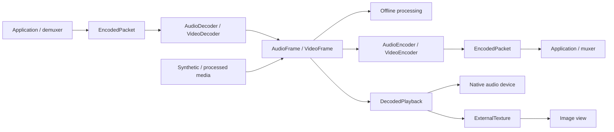

# Codec and decoded-playback design

Status: shared CPU media values and the first AAC/AVC decoder milestone are implemented. See the
[decoding guide](mediacodec.md) for the exported API, supported subset, actual platform validation, and current limits.
The playback and encoder sections remain design work; the broader acceptance plan below is not a claim of completed validation.

The current implementation uses concrete asynchronous Probe calls, without hardware selection/classification. Windows
starts with synchronous system MFTs; Linux is an explicit optional GStreamer dependency. Video reserves a conservative
34-frame capacity and a 16-frame presentation window. Low-latency tuning, asynchronous MFT enumeration, hardware policy,
and native optimizations remain later milestones. Runtime acceptance is recorded separately for each platform.

Lib-Media will implement the codec foundation first, then build decoded-input playback on the resulting media values.
Encoding belongs to the codec feature, but completing every encoder is not a prerequisite for decoded playback.
Android, iOS, macOS, Windows, Linux, and Web are all design and implementation targets. Delivery is organized by
capability, with platform feasibility checked before freezing shared interfaces; desktop and browser semantics are
not deferred until after mobile API decisions. This document does not change the existing MediaPlayer or photo-library APIs.

## Requirements and ownership

[Issue #20](https://github.com/HuxerUI/HuxerUI/issues/20) requests independent codec sessions, capability discovery,
explicit ownership, and deterministic asynchronous processing. [Issue #102](https://github.com/HuxerUI/HuxerUI/issues/102)
requests playback of decoded input, including audio output, video scheduling, and synchronization. Their original SDK
packaging language is superseded by the agreed Lib-Media repository, namespace, and `HuxerUI::Media` target.



| Owner | Responsibility |
| --- | --- |
| Application or source library | Reading, container parsing, stream selection, source seeking, and coordinating independent sessions |
| Codec session | Configured conversion between encoded packets and raw frames, with bounded buffering |
| DecodedPlayback | Device output, playhead, audio/video queues, frame selection, and synchronization |
| ExternalTexture | The currently selected visual frame and renderer synchronization |
| Existing MediaPlayer | Complete-source playback through platform players |

No file/URL loader, demuxer, muxer, editing graph, or global codec registry is introduced in this phase. MP4 bytes are
not decoder input: the caller must supply complete codec access units and initialization data. Tests use packaged
packet fixtures with known boundaries and timestamps, rather than growing a container parser inside the decoder.

## Public surface and naming

All types remain in `huxerui::media`. Public headers and remaining planned headers are:

| Header | Proposed contents |
| --- | --- |
| `mediaformat.h` | Exact timestamps, audio/video format descriptions, encoded packets, and owned raw frames |
| `mediacodec.h` | Capability probes, codec configuration, errors, and typed encoder/decoder sessions |
| `mediaplayback.h` | Later decoded-input playback; consumes the same format and frame types |
| Existing `mediaplayer.h` | Existing file/reference/URL player, unchanged |
| Existing `medialibrary.h` | Existing selection and publication, unchanged |

Use `AudioDecoder`, `VideoDecoder`, `AudioEncoder`, and `VideoEncoder` as concrete, move-only session handles. These
four names express different input/output types; they do not imply four copies of the internal queue/state machinery.
Use `DecodedPlayback` for the later combined audio/video consumer. Do not overload MediaPlayer with raw-frame inputs,
introduce a public Session base class, or create separate AudioBuffer, PCMBuffer, and AudioFrame wrappers for the same data.

Errors use the installed SDK's `Result<T, CodecError>`. `CodecError` owns codec-specific codes, a diagnostic message,
and a platform diagnostic identifier. Reusing playback's `MediaError::fatal` or photo-library errors would import
unrelated lifecycle meanings. Proposed categories are `Unsupported`, `InvalidArgument`, `InvalidState`, `InvalidData`,
`ResourceExhausted`, `PlatformFailure`, and `Closed`. Queue saturation is an ordinary submission outcome, not an error.

## Shared media values

### Time

Introduce one exact `MediaTimestamp` value containing a signed 64-bit tick count and a positive 32-bit timescale.
Its value is ticks / timescale seconds. This represents 44.1 kHz samples and 90 kHz video timestamps without cumulative
floating-point rounding. Negative presentation times are legal for preroll. Missing timestamps use `std::optional`,
not a reserved integer or NaN.

Packets carry required PTS, optional DTS, and optional duration. Frames carry required PTS; audio duration is derived
from sample-frame count and sample rate, while video duration can be unknown. Duration values use the same rational
representation and must be nonnegative. DTS determines packet submission order when provided; PTS need not be monotonic
in compressed input. Session data belongs to one stream and one timeline generation.

Arithmetic uses checked rational operations. Platform conversion rounds to the nearest supported tick, with a documented
tie rule and overflow rejection; durations are calculated from absolute sample positions rather than adding rounded
per-buffer durations. Preserve the existing double-based `MediaTime` for MediaPlayer/UI compatibility. Conversion at
that boundary is explicit; existing player signatures are not migrated as part of this feature.

### Audio

`AudioFormat` describes sample rate, sample representation, packing, and an ordered channel layout. Start with signed
16-bit and float32 PCM, interleaved or planar, with mono and stereo layouts. Format support is queried, not assumed.
Channel count is derived from the layout; bytes per sample and frame duration are derived rather than separately stored.
Other layouts and representations return `Unsupported` until implemented.

`AudioFrame` is a retained read-only value with a format, PTS, sample-frame count, and planes. A sample frame contains
one sample per channel. Interleaved audio has one plane; planar audio has one plane per channel. Validate frame counts,
plane sizes, multiplication overflow, and alignment before submission. Audio format conversion, resampling, and mixing
are separate operations; the codec API must not silently substitute an application's requested output format.

### Video

`VideoFormat` describes coded pixel size, visible rectangle, pixel layout, pixel aspect ratio, and color metadata
(primaries, transfer, matrix, and range). Unknown color facts remain unknown; they are not silently labeled sRGB.
Rotation is presentation metadata, not an implicit rewrite of decoded pixels.

`VideoFrame` owns its format, PTS, optional duration, and retained planes. Each plane carries a byte range, row stride,
and pixel stride. Validation accounts for subsampling, visible crop, the final addressed sample, and integer overflow;
planes are never assumed tightly packed. The initial CPU layouts are I420 and NV12 for decoder output. Packed RGBA/BGRA
are candidates for later presentation input, not a reason to convert every decoded frame to RGB.

Initial output is CPU-readable and library-owned. Unsupported vendor layouts fail explicitly rather than exposing
an incorrect YUV interpretation. Native-only frames and explicit CPU mapping can be added after a backend demonstrates
a concrete benefit and the lease/synchronization contract is tested. An ExternalTexture is never the codec frame type.

### Encoded packets and configuration

`EncodedPacket` contains a retained payload, timing, and a random-access/key-frame indication. It is one complete codec
access unit for one stream. There is no filename, URL, track registry, or implicit container ownership in this type.

Configuration distinguishes the codec from its packet representation. The initial implemented formats are:

| Codec | Input contract |
| --- | --- |
| AAC-LC | One raw AAC access unit per packet, with AudioSpecificConfig supplied at decoder creation; no implicit ADTS parsing |
| H.264/AVC | Length-prefixed access units with AVCDecoderConfigurationRecord and its NAL length size; no implicit Annex B detection |

Adapters may perform the small, bounded packet/configuration conversion required by their native API. That conversion
must be explicit in adapter tests and is not general demuxing. Reject malformed initialization data, truncated lengths,
and unsupported profiles before unsafe native submission. A video stream begins at a decodable random-access point;
reset requires a fresh random-access sequence. Testing includes frame reordering, not just all-intra fixtures.

Encoder output configuration is delivered before packets that depend on it. Packet PTS/DTS, key-frame flags, and encoder
priming/padding metadata must survive adaptation where reported. Missing DTS or trimming metadata stays explicitly
unknown; it must not be fabricated from PTS. Initial encoder support may reject frame reordering if DTS cannot be
reliably represented by the backend.

## Storage and bounded memory

Reuse SDK `Bytes` and `BufferReference` for byte storage and retained read-only ranges. The latter is not an immutable
snapshot by itself: its owner can still mutate backing storage. The initial submission rule is therefore deliberately
simple for the initial implementation:

- `TrySubmit(const EncodedPacket&)` copies an accepted payload into the bounded input pool before returning. Callers
  can reuse their source bytes after return. A rejected submission consumes nothing.
- Decoder output is copied or normalized into owned CPU-frame storage before the native output slot is released.
  Its lifetime is independent of session reset and close. There is no public `ReleaseOutput(index)` operation.
- Future encoder frame submissions use the same copy-on-accept rule initially. A retained-input fast path is a separate
  future decision requiring an explicit immutable-storage or completion contract.

`QueueLimits` specifies maximum input items/bytes and output items/bytes. A packet or maximum configured frame that
cannot fit is rejected as invalid configuration/data, not left permanently in a WouldBlock state. Counts include queued
and in-flight reservations; output allocations still retained by consumers continue to charge the same output pool.
Reset does not create a new unlimited pool while old output references survive. Old outputs remain readable and can
apply backpressure to a new generation until released.

Copied-input credit follows the last retained byte owner, including adapters that hold an input callback buffer beyond
frame production. Once native submission no longer needs those bytes, the session retains timing only; in-flight native
conversion remains charged to output reservations. Each adapter reserves output capacity before scheduling work, including native reordering/delay allowances. It may stop
feeding native input when credit is exhausted. If a backend cannot bound outstanding callbacks/native allocations, that
configuration is unsupported in the bounded mode. Input duration and codec delay must be considered for audio packets
that can produce more than one output buffer. Do not promise a fixed process RSS: platform-internal allocations are
measured separately from the library's item/byte bounds and constrained by configured dimensions and codec limits.

Output release is thread-safe and wakes producers without calling user code from a buffer destructor. No queue silently
drops codec output. An application that retains all output must expect backpressure; drain cannot complete indefinitely
without the caller reading and releasing output.

## Execution model

The codec core uses no `View`, `Runtime`, window module registration, or `Install()` hook. Construction selects the
compiled platform adapter directly. Platforms may require a native event loop, JVM availability, or a particular worker
context; those restrictions are capability facts, not a requirement to create a HuxerUI Runtime.

The installed SDK's `AwaitCallback` starts on a running Task's UI thread and resumes through its dispatcher. It is an
optional UI adapter, not the codec execution mechanism. The core uses nonblocking queue/control operations and callbacks
that also work in a native command-line program or a browser DedicatedWorker. No blocking public Wait/Join or
platform-specific Close overload is added.

The decoder API has the following shape; the exported headers include full contracts and configuration types:

```cpp
enum class SubmitStatus { Accepted, WouldBlock };
struct EndOfStream {};
using VideoDecodeOutput = std::variant<VideoFormat, VideoFrame, EndOfStream>;

class VideoDecoder {
public:
  static Result<VideoDecoder, CodecError> Create(const VideoDecoderConfig& config);
  Result<SubmitStatus, CodecError> TrySubmit(const EncodedPacket& packet);
  Result<std::optional<VideoDecodeOutput>, CodecError> TryRead();
  Result<void, CodecError> Finish();
  Result<void, CodecError> Reset();
  void Close() noexcept;
};
```

Each codec configuration carries the same two optional callback fields:

| Field | Proposed type | Purpose |
| --- | --- | --- |
| `wakeup` | `std::function<void()>` | Coalesced notification that readiness, output, or operational state may have changed |
| `cleanup_completed` | `std::function<void(Result<void, CodecError>)>` | One terminal result for cleanup of this session's resources and application callback activity |

Callbacks are supplied at Create so cleanup can be observed even after the public handle is destroyed. This avoids a
second future/promise abstraction, late subscription rules, and a list of repeated-close listeners. A caller needing
completion registers it when constructing the session; calling Close repeatedly does not register another callback or
restart cleanup. A later Task adapter can install these callbacks and suppress its own canceled continuation.

AudioDecoder uses corresponding audio format/frame outputs. Encoders accept typed raw frames and yield configuration
changes, packets, and end-of-stream. No generic variant permits audio input to a video session.

### Creation and dispatch

Create performs synchronous argument validation, allocates the control state, and schedules native initialization. A
successful call publishes a session initially in Starting; it may advance before the call returns. Success does not
guarantee native configuration has completed.
Native creation/configuration runs on the adapter's worker or owning browser event loop. Success changes Starting to
Running and schedules wakeup; failure records an operational error, enters Failed, and begins cleanup. A synchronous
Create failure returns no session and schedules no user callbacks; allocations must be released before that failure
returns. Starting is cancellable through Close, including when a platform capability promise is still pending.

TrySubmit and TryRead never wait for codec work. Accepted input is still copied within its configured size limit, so
these are not hard-real-time audio callback operations. Queue operations support a concurrent producer and consumer;
submissions are ordered by acceptance. Control transitions are linearized with queue and callback admission. Callers
must not destroy or move the public handle concurrently with a call using that same object.

Each native session and probe owns a serialized worker for codec calls. Session wakeups run there, separate from
native codec callbacks. A shared dispatcher delivers cleanup and probe results after the corresponding worker exits.
On Web codec work and callbacks run on the owning event loop. No user callback runs under a library lock or inline on
an API call's stack. A callback on another thread may race the initiating call's return, so callbacks must capture
independently owned context rather than assuming the caller has already assigned the returned handle.

Readiness notifications may coalesce. The application drains TryRead and retries pending input until it would block.
A state change during notification schedules another wakeup if the session remains operational, preventing lost
readiness. A notification carries no frame and is only a hint; it can be stale by the time application work runs.
Callbacks must not throw or block. They may signal an application executor; they must not synchronously wait for work
on the codec/control lane. Close is safe from a wakeup callback because it only retires the session and queues cleanup.
Cleanup completion is dispatched after that wakeup returns, never recursively inside it.

## Results, ordering, and lifecycle

### Operational states

| State | TrySubmit | TryRead | Control behavior |
| --- | --- | --- | --- |
| Starting | WouldBlock; no input consumed | Empty until ready, or the initialization error if it fails | Close is allowed; Finish/Reset return InvalidState |
| Running | Accepted or WouldBlock | Next output or empty | Finish seals input; Reset begins a discard/restart; Close retires |
| Resetting | WouldBlock; no input consumed | Empty until reset succeeds, or its error if it fails | Repeated Reset coalesces; Finish returns InvalidState; Close takes precedence |
| Draining | InvalidState | Remaining output, then one EndOfStream | Finish is idempotent; Reset discards the drain; Close retires |
| Ended | InvalidState | Empty after EndOfStream was read | Finish is idempotent; Reset starts a new generation; Close retires |
| Failed | Stored operational error | Stored operational error | Finish/Reset return InvalidState; Close changes the state to Closed |
| Closed | Closed error | Closed error | Finish/Reset return Closed; repeated Close is a no-op |

Accepted means input was copied and queued, not that it was converted or played. An empty TryRead optional means no
output is ready; it never means EOS. A format event precedes frames/packets using its canonical AudioFormat/VideoFormat,
and each frame keeps its own complete description. Video decoder output is in presentation order, with bounded native
reordering accounted for. Unsupported ordering or native corruption/drops fail explicitly.

Finish succeeds when the input-sealing command is accepted, transitions Running to Draining, and preserves all earlier
accepted input. It does not await native drain, release the codec, or start cleanup. EndOfStream is queued after all
delayed output; consuming that event changes Draining to Ended. Retained output can stall draining, so callers must
continue reading and releasing buffers. Close before drain completes discards pending output and EOS.

### Reset is an asynchronous discard barrier

Reset succeeds when its logical barrier is established: advance the generation, discard queued input/output/format/EOS,
and enter Resetting. After that barrier no new read can obtain old queued output. A read that won the race before Reset
may return its already-acquired immutable value; neither Reset nor Close revokes an operation already linearized.
Previously returned buffers remain valid.

Native flush/recreation runs asynchronously on the owning adapter lane using the same configuration. TrySubmit remains
WouldBlock until it completes; then Running and wakeup announce new readiness. Repeated Reset in Resetting shares the
same pending reset instead of stacking native instances or replenishing retained-output credit. A reset failure enters
Failed and initiates cleanup. Input codec/configuration changes require a new session in the first version.

Every native callback/job is tagged with its internal generation. An old completion cannot publish a frame, state change,
format, or EOS into a new generation. An already admitted wakeup may finish as a harmless readiness hint, since it carries
no frame. The application must cancel/join its own old producer and discard previously scheduled application work before
feeding a new timeline; a fresh API submission of old source data cannot be identified by the codec alone.

There is no Flush alias: Finish preserves and drains; Reset discards and restarts. Canceling a caller's wait does not
retract accepted input. Close interrupts Starting, Resetting, and Draining without waiting for their native work; any
resource acquired by a late initialization/reset result is sent to cleanup, not installed into the retired session.

### Close is logical retirement

Close establishes an immediate terminal barrier on every platform. It changes the state to Closed, retires the generation,
disables admission of new wakeups, makes pending input/output inaccessible, and schedules cleanup exactly once. It performs
no codec stop/delete, thread join, device drain, browser wait, or user callback on the caller's stack. Short control
synchronization is allowed; unbounded native waiting is not. Potentially expensive queue destruction is also deferred.

A wakeup admitted before the barrier may already be running, or resume after Close returns if its thread was preempted.
Close therefore does not authorize destroying callback captures or unloading callback code. No wakeup is admitted after
the barrier; queued but unadmitted notifications are canceled. Native completion handlers may still run internally to
release results, using retired control state rather than a raw public-handle pointer. They cannot resume application work.

Close always discards rather than drains. Call Finish and consume EndOfStream first when lossless draining is required,
then Close to release the session. Native cancellation is best effort; logical retirement is unconditional. Cleanup
failure cannot reopen the session, and repeated Close never repeats native teardown or terminal notification.

### Cleanup completion is a separate terminal result

When configured, `cleanup_completed` is emitted once after a successful Create when explicit/destructor Close or an operational
failure has initiated cleanup. Finish, EOS, and a successful Reset do not emit it. Cleanup has internal Pending,
Succeeded, and Failed outcomes; these do not add another public session-state enum. Operational Failed can coexist with
successful cleanup. The cleanup result describes release, not the earlier decoding/encoding outcome.

Success means all of the following have been established:

- Every wakeup admitted before retirement has returned. Unadmitted wakeups and their captures have been retired; no
  further application readiness callback can begin for this session.
- Native initialization, conversion, reset, copy, and release work owned by the adapter is complete or safely detached
  under the native API's cancellation/release contract. Callback bridges can no longer access application captures or
  the public handle, and late results cannot re-enter library queues.
- All session-owned codec handles, internal input/output references, timers, callback registrations, and per-session
  worker resources have been released. Shared executors may remain alive for other sessions.
- Ownership bookkeeping has been separated from caller-owned CPU outputs and the small terminal callback/result record.
  Keeping those outputs does not retain the native codec or delay cleanup completion.

This is a library/API-level completion guarantee, not a promise that the OS, driver, garbage collector, or browser has
physically freed every internal allocation or made hardware immediately available. Returned immutable CPU buffers remain
readable and are freed when their last owner releases them. Native-frame optimizations may not weaken this contract:
they need independently releasable storage or a separately reviewed lease contract before being exposed.

On a reported native release failure, attempt remaining cleanup and deliver Failure(PlatformFailure) only after application
callback access is safely quiescent. A failure result does not certify release of all native resources; preserve the
platform diagnostic and account for any isolated residual resources. Never manufacture a success after a timeout. If a
native call or admitted application callback never returns and cannot safely detach, completion stays pending; the caller
may time out its own observation, but must not free state still reachable by that work. There is no safe force-kill API.

Completion runs on the serialized control lane after earlier admitted wakeups have returned and after cleanup has reached
its terminal outcome. It is never inline, including when cleanup finished quickly. It can execute concurrently with the
initiating call on another thread. The completion callback itself and its captures live until it returns, then release;
this callback is the final application callback delivered by the session. User work previously posted by a wakeup belongs
to the application and must be retired separately; the library cannot retract arbitrary application executor jobs.

A fatal operational error enters Failed, schedules a terminal wakeup, and starts the same cleanup path. If Close wins
before that wakeup is admitted it is suppressed; the cleanup callback still occurs. When cleanup follows failure, the
stored operational error remains readable while the handle is in Failed. A later Close changes it to Closed without
emitting a second cleanup completion. Callers needing diagnostics must record operational and cleanup errors separately.

### Destruction, execution context, and observation cancellation

The session destructor uses the same nonthrowing logical-retirement path as Close and does not wait for cleanup. Internal
control state is retained by outstanding jobs until cleanup completes, so destroying the public handle cannot create a
native use-after-free. Moving a handle transfers ownership; a moved-from destructor does nothing. Callbacks must capture
owned/weak application state, never a reference to a stack handle whose lifetime they assume will extend through cleanup.

For controlled shutdown, stop producers, call Close, observe cleanup_completed, and let its dispatch finish before
retiring session-owned application state. Per-session completion does not authorize unloading native code or WASM while
shared executors, other sessions, or the final callback dispatch itself still use it. Host shutdown needs its own fence
covering all such users; no general library-unload API is introduced here. In particular, an application must not
terminate a DedicatedWorker or destroy its WASM module while cleanup still needs that context. Forced process, page,
or worker termination cannot promise callbacks or a graceful cleanup result.

Capability probes independent of a session own their own observation lifetime. Initialization/probes started for a session
are part of its cleanup accounting; late promise resolution cannot resurrect it. Canceling a UI Task adapter only removes
its result delivery; if the adapter requested Close, cleanup continues and its internal terminal handler still releases
resources. No callback delivery is made dependent on a still-mounted View or a live UI Task.

Web calls execute on the codec's owning JS event loop; other workers marshal commands rather than synchronously proxying
them onto a blocked event loop. Native backends may accept cross-thread queue/control calls with the same linearization
rules. Neither platform group permits blocking the control lane while awaiting reset, drain, or cleanup completion.

## Capabilities and platform adapters

Probe a concrete operation/configuration, not just a codec name. The response includes supported packet layout,
profiles/limits, actual raw output formats, and hardware/software classification when knowable. Hardware-only selection
must fail if unavailable; default selection may use a system-provided software codec. No bundled FFmpeg fallback is
added. Discovery must not create an application-wide registry, and successful probing does not guarantee later creation.

| Platform | Proposed codec implementation | Validation gate |
| --- | --- | --- |
| Android | MediaCodec through NDK where its public API suffices; narrow JNI only for capabilities/formats unavailable through the NDK | AAC-LC/H.264, CPU plane layout/crop, EOS/reset, bounded in-flight work on real hardware |
| iOS/macOS | AudioConverter for audio; VideoToolbox and CoreMedia for video | AAC configuration, PCM packing, AVC configuration, CVPixelBuffer planes, reordered/delayed output |
| Windows | Media Foundation transforms | COM worker ownership, sync/async MFT differences, negotiation and stream changes |
| Linux | Optional GStreamer codec pipeline with appsrc/appsink | Explicit dependencies and installed plugins; all library and pipeline queues bounded |
| Web | WebCodecs adapter | Secure-context/worker availability, promise-based probes, event-loop cleanup, browser resource reclamation |

### Platform scope and execution

| Platform | Execution and deployment boundary | Required platform checks |
| --- | --- | --- |
| Android | Native codec worker; no Activity or HuxerUI Runtime for NDK decoding. JNI probes, if needed, require the application's JVM rather than a window. | API-level symbols, vendor layouts, hardware/software selection, retained frames, and device codec limits |
| iOS | AudioConverter/VideoToolbox workers and native callbacks; decoding alone does not install playback audio-session policy. | Real-device decoding in addition to simulator builds, interruptions/resource loss, and output lifetime |
| macOS | Maintain the native adapter in the macOS platform sources and run headless desktop tests. | Intel/Apple Silicon support where tested, native format negotiation, resource release, and CPU output access |
| Windows | Initialize COM and Media Foundation on controlled workers; adapt both synchronous and asynchronous transforms. | Installed media components, software/hardware transforms, stream changes, delayed output, and native resource lifetime |
| Linux | Explicit optional GStreamer dependency; resolve installed codec elements without silently installing plugins or bundling a universal fallback. | Plugin discovery, missing-plugin errors, appsrc/appsink and internal queue bounds, and headless execution without GTK initialization |
| Web | WebCodecs in a supported secure browser context, preferably a DedicatedWorker; no blocking waits on its owning event loop. | Promise-based configuration probes, callback ordering, queue limits, browser reclamation, reset/close races, and independent audio/video codec availability |

The library's existing GTK playback dependency is not itself a codec implementation. Linux codec support needs its own
declared GStreamer build/runtime dependency and plugin capability checks. A codec-only consumer must not initialize GTK
or open a display, even if the complete library's build also includes its existing playback adapter. The exact minimum
GStreamer version is selected after checking the queue-control APIs used by the implementation.

Web support is probed per operation and configuration; the presence of VideoDecoder does not establish AudioDecoder or
encoder support, and AAC/AVC availability is not guaranteed across browsers. Capability failure and missing APIs are
explicit Unsupported results. There is no hidden WASM codec download. Native hardware/software classification is only
reported when a platform can establish it; preference hints are not proof that hardware was selected.

All six targets implement the same logical Close barrier and separate cleanup_completed result described above.
Native API spelling does not determine the portable contract: browser flush is used for drain, whereas reset is a discard;
GStreamer state teardown is scheduled away from streaming callbacks even when its native state call is synchronous.

Every capability milestone carries a platform matrix with separate entries for adapter implementation, compilation,
runtime validation, tested codecs/configurations, and known unsupported cases. A backend with only an Unsupported stub
is not counted as implemented; a successful cross-build is not a runtime pass. Missing hardware or browser coverage is
recorded as unvalidated, not silently treated as supported. Common contract tests are reused across all adapters.

These mappings are candidates rather than claims of implemented support. Android API-level availability must be checked
per symbol, keeping the existing API 23 library minimum. The first Android backend can poll native dequeue operations
on its worker rather than raising the minimum solely for newer callback APIs. Validate the iOS backend on iOS devices
and the macOS backend on the development Mac.

Native reference material: [Android NDK media APIs](https://developer.android.com/ndk/reference/group/media),
[Apple Audio Converter Services](https://developer.apple.com/documentation/audiotoolbox/audio-converter-services),
[VideoToolbox](https://developer.apple.com/documentation/videotoolbox),
[Media Foundation transforms](https://learn.microsoft.com/en-us/windows/win32/medfound/media-foundation-transforms),
[GStreamer app integration](https://gstreamer.freedesktop.org/documentation/app/index.html), and
[WebCodecs](https://www.w3.org/TR/webcodecs/). Adapter details and support claims are verified against these contracts
when each backend is implemented.

### Lifecycle mapping for all six targets

Every row uses the same public states and callbacks. The differences below are adapter work, not alternative public
Close/Reset semantics. Native methods are called only on a context where their potentially blocking behavior is safe.

| Platform | Reset preparation after the logical barrier | Cleanup before terminal success |
| --- | --- | --- |
| Android | Serialize flush or stop/reconfigure on the codec worker; invalidate old output indices and restore configured readiness before accepting new input. | Stop input/dequeue work; finish or retire outstanding native calls; release codec/output/JNI references on their required contexts; retire bridges and per-session worker work. Never wait for this in Close or a MediaCodec callback. |
| iOS | Serialize AudioConverter reset or VideoToolbox reset/recreation; retire old decode callbacks and frame-copy jobs before reopening input. | Resolve in-flight converter/decompression work, invalidate/dispose native sessions and release CoreMedia/CoreVideo references off native callbacks. Marshal retirement to the control lane only after application wakeups have returned. |
| macOS | Use the same Apple generation and reset rules without depending on AppKit or a UI run loop. | Apply the same converter/VideoToolbox release accounting as iOS; desktop worker shutdown and retained CVPixelBuffer/copy jobs are covered by completion. No assumption that a Mac-only test validates iOS lifetime behavior. |
| Windows | Process discard/flush and stream reinitialization on the owning COM/MF worker; handle asynchronous MFT events through generation-checked bridges. | Stop submissions/event admission, call the transform's supported shutdown/release path, release outstanding samples and per-session COM references, then retire worker work. Balance library-owned MF/COM initialization without shutting down facilities owned by other sessions or the app. |
| Linux | Use a controlled GStreamer flush/restart boundary, keeping appsrc/appsink and internal queue limits; drop old samples/events and re-establish readiness. | Detach application-facing signals/bus delivery, stop streaming via the pipeline's NULL transition on a control context, release samples/elements/bus references, and retire streaming/control work. Do not tear down from the streaming callback being quiesced or globally deinitialize GStreamer. |
| Web | Call WebCodecs reset and reapply configuration on its owning event loop, or recreate when needed. Reset aborts an earlier flush promise; treat that as a stale generation, not a new-session failure. | Call codec close, settle or safely detach guarded promises, close held AudioData/VideoFrame objects after their copy work, drop JS/WASM bridges and session-owned references, then deliver completion on a later event-loop turn. Never spin, block, or wait for browser-internal hardware acknowledgement that the API does not expose. |

Web late callbacks may retain only an inert JS-side retirement guard when the browser cannot unregister them. Such a
guard must release an unexpected native result without entering retired WASM code or retaining application captures;
otherwise the job remains outstanding and cleanup cannot succeed. A fixed number of extra event-loop turns is not proof
that arbitrary browser callbacks have finished. Browser close's documented release semantics delimit what can be
confirmed; internal codec/cache/driver work beyond that boundary is not exposed as a fabricated completion fence.

On native platforms, the session worker performs native release and then exits. The completion dispatcher joins only
workers that have finished releasing thread-local resources. A stuck native operation or thread exit in one session
does not delay other sessions' codec work or cleanup. Platform startup references may have their own library lifetime;
per-session cleanup does not shut down the host SDK. Backend release errors and unavailable callback-detachment
guarantees remain explicit.

The mappings are grounded in the [Android NDK codec lifecycle](https://developer.android.com/ndk/reference/group/media),
[Apple's asynchronous decompression guidance](https://developer.apple.com/videos/play/wwdc2014/513/),
[asynchronous Media Foundation transforms](https://learn.microsoft.com/en-us/windows/win32/medfound/asynchronous-mfts),
[GStreamer element states](https://gstreamer.freedesktop.org/documentation/gstreamer/gstelement.html), and
[WebCodecs lifecycle algorithms](https://www.w3.org/TR/webcodecs/). They still require native implementation tests;
this design does not claim that every driver is bounded or that release cannot fail.

## Decoded playback boundary

After decoding works, `DecodedPlayback` consumes AudioFrame/VideoFrame without owning their producer or decoder.
Audio-only and video-only configurations do not manufacture a missing track. Initially accept exact configured formats;
conversion/resampling is explicit and capability checked. Its independently bounded queues retain shared immutable
frames; holding those references may in turn backpressure the decoder's output pool.

The planned playback policy is:

- With audio, use native consumed/presented sample position and latency information as the master clock, not the number
  of submitted bytes. With video only, anchor a monotonic clock to the configured timeline start.
- Pause freezes the clock and preserves queued content. On audio underrun, allow already queued hardware audio to finish,
  then freeze at the last media sample; resume from that position when a configured refill threshold is met. Any device
  silence inserted to keep output alive does not advance the media playhead.
- Publish video frames when due. In real-time playback, superseded late video frames may be dropped with a reported
  counter; offline codec output never uses this policy. An empty video queue does not stop an audio master clock.
- Reset the playback timeline explicitly for seeking/discontinuity. The application resets its source, decoder, and
  playback under its own barrier. Playback does not invoke decoder Reset or seek files on the caller's behalf.
- End-of-input is per enabled stream. Completion requires native audio drain and reaching the final video presentation
  endpoint. Unknown final video duration needs an explicit end timestamp or a documented last-PTS endpoint rule.
- Device loss/interruption is reported; background execution, audio focus, and Apple audio-session policy remain app-owned.

Concrete queue durations, late-frame thresholds, and synchronization tolerance are playback configuration/measurement
work in #102. The design does not claim an unmeasured cross-platform latency or accuracy guarantee. Format changes
require an explicit playback reconfiguration boundary in the first implementation, rather than silently restarting audio.

DecodedPlayback adopts the same separation: Close logically stops admission and scheduling immediately; cleanup
completion follows retirement of audio-device work, timers, presentation jobs, and application callbacks. A successful
Finish/drain is a different event and must account for audible completion. Close may allow already committed device
samples to finish until native stop takes effect; it does not claim immediate physical silence. No new frame publication
may be admitted after the logical barrier; cleanup waits for already admitted publication calls to return. A renderer's
snapshot or a caller-retained ExternalTexture may retain its last published frame independently. Its eventual release
is not a reason to hold the playback session open, and playback closure never closes its external decoder.

Only the selected frame is sent to an existing SDK texture. Compatible output keeps texture identity stable; a change
to intrinsic logical size creates a new texture and one structural UI update. Per-frame data does not flow through State
or PlatformPayload. Visibility may avoid visual conversion, but does not authorize pausing audio or retiring the session.

## SDK reuse and open integration gates

This design was checked against the installed SDK selected by `HuxerUI_DIR` in the active CMake cache.
Consumers use the public installed package; no SDK source checkout is required.

| Existing public facility | Design use |
| --- | --- |
| `data.h`: Bytes, BufferReference, Result | Storage ranges and typed results; no replacement generic buffer or result type |
| `task.h`: Task/AwaitCallback | Optional UI convenience integration only; currently requires a running UI Task |
| `external_texture.h` | Presentation identity, immutable intrinsic size, revision, and visibility |
| Platform texture headers | Existing renderer-recognized import/publication paths |

The installed Android texture API exposes BitmapTexture and a GL_TEXTURE_2D copy path. Apple exposes retained
PixelBufferTexture and Metal copies; Windows/Linux expose pixel/native texture paths. These are actual public contracts,
not a generic promise that every codec output can be imported without conversion. The first CPU decoder milestone needs
no new SDK interface. Renderer-compatible YUV/color conversion and import are a separate gate before a preview ships;
unsupported import must be reported rather than disguised with an unrecognized ExternalTexture subclass.

A future native-frame optimization may require a generic renderer import capability, especially for Android native
buffers or specific YUV/HDR layouts. Specify and test the exact missing resource, synchronization, and color contract
before asking the SDK agent to add it. Do not modify the adjacent SDK repository or introduce private renderer access.
Native resource release may require a worker even after session retirement; a native-frame extension must define that
lifetime independently before replacing the initial owned CPU output.

## Delivery plan and acceptance

| Milestone | Deliverable | Acceptance gate |
| --- | --- | --- |
| Cross-platform feasibility | Small codec probes for all six targets, including browser lifecycle behavior | Native operations and callback cleanup mapped before API freeze; unavailable validation recorded explicitly |
| Shared contract | mediaformat.h values, validation, checked timestamps, owned planes | No UI dependency; overflow/stride/time tests; API redundancy review; common lifecycle contract |
| Audio decoding | AAC-LC to requested supported PCM on each capable backend | Packet fixture to PCM, sample counts/timing, bounded memory, EOS and reset; platform support matrix |
| Video decoding | AVC to supported CPU YUV on each capable backend | Plane/crop checks, B-frame order, format changes, retained output after close; platform support matrix |
| Decoded playback | Audio device output, then video presentation and A/V scheduling | Synthetic input plus real decoder pipeline, measured timing, independent lifetimes |
| Encoding and expansion | Typed encoders across target platforms and additional formats | Configuration events, priming/reordering metadata, round trips, capability/dependency reports |

Codec fixtures include initialization data, packet boundaries, timing, expected output dimensions/sample counts, and
provenance. Use generated media owned by the project. Compare PCM/video with codec-appropriate tolerances rather than
assuming bit-identical output across native implementations. First tests write/read raw data or verify checksums and
sample counts; hearing audio is not a decoder acceptance criterion.

Shared tests stress queue saturation, oversized packets, held output across repeated resets, EOS under backpressure,
format changes, concurrent submission/read/reset, and output lifetime. The lifecycle suite below is required for every
adapter, with deterministic fake-backend ordering tests plus available native/browser runs.

| Scenario | Required invariant |
| --- | --- |
| Close during Starting or a pending support/configuration query | The handle becomes Closed immediately; late success cannot install a codec, and acquired resources are released or safely detached before cleanup success |
| Close during an admitted wakeup, including Close called by that wakeup | No new wakeup admission; the old callback can return normally; cleanup completion follows it exactly once without self-join or inline reentrancy |
| Close after Finish with delayed outputs or saturated output credit | Pending output is discarded; cleanup does not wait for the application to drain or release its already returned CPU frames |
| Reset during drain, repeated Reset, and Close racing Reset completion | Only the current generation can reopen input; repeated resets do not create unlimited instances; Close is terminal |
| API calls racing barriers | Calls linearized before a barrier keep their documented outcome; later calls see Resetting/WouldBlock or Closed, with no old queued result crossing the barrier |
| Destructor without explicit Close and moved-from destruction | The owned session retires once without blocking destruction; outstanding work never dereferences the destroyed handle |
| Initialization/processing failure followed by Close | Operational and cleanup errors remain distinct; automatic cleanup and repeated Close share one terminal completion |
| Release failure, stuck native call, or stuck wakeup | No premature success; reported failure preserves callback safety and diagnostics, while unsafe-to-detach work keeps completion pending |
| CPU output retained through cleanup | Bytes remain readable; only their storage/accounting remains alive, not the native codec or application callback captures |
| Web late promise/native callback and controlled worker shutdown | Retired callbacks cannot enter freed WASM or restore state; cleanup observation completes before terminating its owning worker |
| Canceled UI observation | UI continuation is suppressed while the independent cleanup path still finishes and releases captures |
| Two sessions sharing platform initialization/executors | Closing one does not terminate shared facilities or deliver callbacks to the other session's state |

Native tests also cover unavailable codecs, invalid streams, memory pressure, and resource release counters. Successful
cleanup is observed through the callback and adapter accounting, never inferred from elapsed time or zero output queues.
Build a small non-UI installed-SDK consumer to prove there is no hidden Runtime or source-header dependency. Measure
Release library growth separately from platform media dependencies and document what unused-feature linking retains.

Before declaring the first public header stable across all targets, complete checks for AAC packet/priming handling, AVC CPU layout/reordering, and asynchronous
lifecycle behavior against every target backend. This is a feasibility gate for the proposed formats, not a claim of
universal codec availability or permission to silently broaden the feature. Bounded copying, headless execution,
logical retirement with observable cleanup, and separate decoder/playback lifetimes are the proposed baseline.
